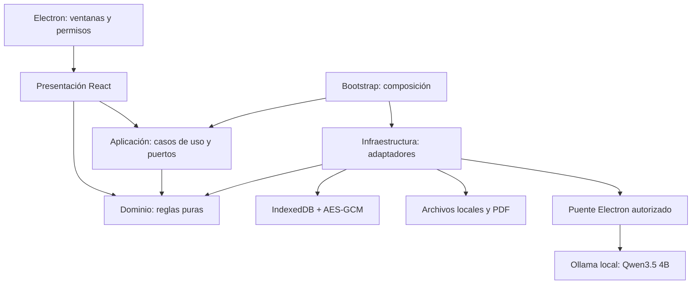

# Arquitectura de la edición de escritorio

Se utiliza un monolito modular con separación por capas, inspirado en Clean Architecture. Una aplicación local no necesita microservicios para separar responsabilidades. Cada módulo reutiliza la sesión y los mismos datos.

## Responsabilidades y dependencias

| Capa | Responsabilidad | Restricción |
| --- | --- | --- |
| `domain` | Pedidos, importes en centavos, aprobación vigente, caja y reglas 3D | No importa React, Electron ni almacenamiento. |
| `application` | Abrir, bloquear, guardar, recuperar, adjuntar, presentar y asistir | Recibe adaptadores por parámetros; no importa infraestructura. |
| `infrastructure` | Persistencia cifrada, archivos, huellas, PDF y Ollama | Implementa los contratos de los casos de uso. |
| `presentation` | Pantallas, interacción, chat y renderizador Three.js | Invoca casos de uso; no accede directamente a IndexedDB. |
| `bootstrap` | Construcción de las dependencias | Es el lugar donde se eligen los adaptadores concretos. |
| `desktop` | Ciclo de vida, permisos y comunicación entre procesos | No ejecuta reglas comerciales ni decide precios. |

`test/architecture.test.mjs` comprueba las dependencias entre capas. La separación es práctica: las pantallas aún incluyen componentes grandes que pueden dividirse sin mover reglas al renderizador.

## Guardado y recuperación

1. Una pantalla solicita una operación al caso de uso.
2. La sesión serializa las escrituras y comprueba que permanezca abierta.
3. El dominio verifica permisos, importes, etapas y referencias.
4. El repositorio valida el estado, cifra con AES-GCM y escribe en una transacción IndexedDB con control de revisión.
5. Solo después del guardado se publica el nuevo estado en la interfaz. Un fallo conserva la versión anterior.

El PIN deriva una clave mediante PBKDF2-SHA-256 con 600 000 iteraciones. Cada guardado utiliza un IV nuevo. El espacio se bloquea tras 10 minutos de inactividad. Una segunda ventana no puede escribir simultáneamente en la misma copia.

La base usa el nombre `creativa-operaciones-v2` para mantener compatibilidad con respaldos locales anteriores de esquema 2/3. El validador rechaza formatos y modos ajenos antes de escribir. No se sobrescribe una base existente al restaurar.

Los datos de usuario están fuera del programa, en el perfil `Creativa-Operaciones` de Electron. Instalar otra versión conserva esa ruta. Esto no reemplaza los respaldos: un disco dañado o la eliminación manual del perfil puede perder los datos.

## Diseño 3D y presentación

La geometría y sus límites pertenecen al dominio. Three.js se carga al abrir la vista y vive en `presentation/preview/renderer`. Las imágenes y máscaras se guardan junto con la versión. Presentar al cliente abre una ventana con sesión temporal separada; recibe únicamente imágenes, geometría y materiales. La sesión de gestión se bloquea y no se entregan datos financieros.

## Asistente

La aplicación interpreta solicitudes frecuentes sin modelo. Para lenguaje libre o análisis, usa el puerto del modelo con Qwen3.5:4b. El puente Electron limita acciones, tamaño de mensajes, cancelación y acceso al proceso principal. Ollama tiene un destino fijo local; el renderizador no puede elegir un servidor o ejecutar comandos.

Los permisos y cálculos siguen en el código. Una propuesta de la IA no confirma cobros, aprueba diseños ni crea pedidos de forma autónoma. Los datos de terceros y las instrucciones dentro de documentos no otorgan permisos.

## Compilación y distribución

Vite compila la presentación en `dist/`. Electron sirve esos recursos mediante `app://creativa`, con aislamiento de contexto, sandbox y Node deshabilitado en la interfaz. La política de contenido permite conexiones del renderizador únicamente al origen local.

Electron Builder empaqueta `dist/`, los puentes de `desktop/` y el cliente local del modelo. Las fuentes de desarrollo y pruebas permanecen visibles en Git; las dependencias y ejecutables generados quedan fuera del historial. Una entrega Windows debe comprobar instalación, reinicio, recuperación e impresión en el equipo de destino.
