# Guía de instalación y primer inicio de Creativa Operaciones

Versión 0.3.1 · 30 de octubre de 2026

[PDF con formato basado en APA 7](GIE-Creativa-Operaciones-Instalacion-APA.pdf) · [Google Docs editable](https://docs.google.com/document/d/1v87c63923RGD2fUscBmqyC2Li2NUH-Mc6SKjNAqvxlE)

El PDF tiene portada, índice, 19 páginas numeradas, márgenes de 2,54 cm, Times New Roman de 12 puntos, interlineado doble en el cuerpo y referencias con sangría francesa. Se adapta la presentación de comandos, capturas y tablas para facilitar su lectura.

## Contenido y uso del manual

- Versiones y requisitos (p. 3 del PDF)
- Preparación y ejecución desde GitHub (p. 4 del PDF)
- Ejecución del portable (p. 13 del PDF)
- Preparación opcional de la IA (p. 15 del PDF)
- Conservación de datos (p. 17 del PDF)
- Solución de incidencias (p. 18 del PDF)
- Referencias (p. 19 del PDF)

Este manual está dirigido a una persona que abre Creativa por primera vez. Para ejecutar las fuentes, sigue los pasos 1 a 9. Si solo quieres abrir el portable, comienza en el paso 10. La preparación de la IA es opcional.

Ejecuta cada comando por separado y espera a que termine. Debajo de cada paso encontrarás el resultado esperado para decidir si puedes continuar.

Todas las figuras contienen capturas reales. Las capturas de terminal se tomaron en Git Bash y PowerShell. Las rutas corresponden a una copia de prueba y pueden variar en tu equipo.

## Versiones y requisitos

La cuenta de GitHub no es necesaria para descargar este repositorio público. Sí necesitas permisos propios si vas a publicar cambios. La aplicación guarda los datos localmente y no requiere Supabase.

La rama de la aplicación es feat/escritorio-local. Esta guía y sus capturas se mantienen en docs/guia-instalacion-onboarding (Creativa Impresos, 2026).

**Tabla 1**

*Componentes necesarios según el modo de ejecución*

| Componente | Cuándo se necesita |
| --- | --- |
| Windows x64 | Plataforma del ejecutable publicado. Para utilizar Ollama: Windows 10 22H2 o Windows 11. |
| Git para Windows | Solo para clonar las fuentes. No se necesita para abrir el portable. |
| Node.js 24 LTS con npm | Solo para instalar dependencias, compilar y ejecutar las fuentes. |
| Electron 44.8.0 | Motor declarado por el proyecto. Se prepara con setup:desktop. |
| Ollama y qwen3.5:4b | Opcionales, para las funciones con IA. Los pesos del modelo no vienen en el .exe. |
| Memoria y espacio | Para la preparación completa con IA se recomiendan 16 GB de RAM y 15 GB libres; no son mínimos certificados. |

## Paso 1. Preparar Git y Node.js

1. Instala Git para Windows desde git-scm.com/install/windows y Node.js 24 LTS con npm desde nodejs.org/en/download.
2. Cierra las terminales anteriores y abre una nueva PowerShell desde Inicio.
3. Ejecuta los comandos siguientes. Deben aparecer números de versión.

```powershell
git --version
node --version
npm.cmd --version
```

**Figura 1**

*Versiones reales de Git, Node.js y npm*

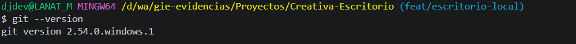

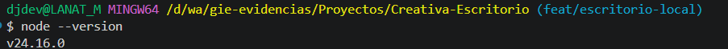

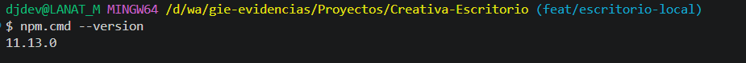

*Nota.* Capturas reales de Git Bash: Git 2.54.0, Node.js 24.16.0 y npm 11.13.0. Las versiones menores de tu equipo pueden variar.

**Resultado esperado.** Git y Node.js responden y npm está disponible.

## Paso 2. Elegir la rama correcta en GitHub

1. Abre https://github.com/milimoon1225-oss/team en el navegador.
2. En el selector de ramas, elige feat/escritorio-local.
3. Comprueba que se vean las carpetas src, desktop y scripts.

**Figura 2**

*Rama feat/escritorio-local del repositorio*

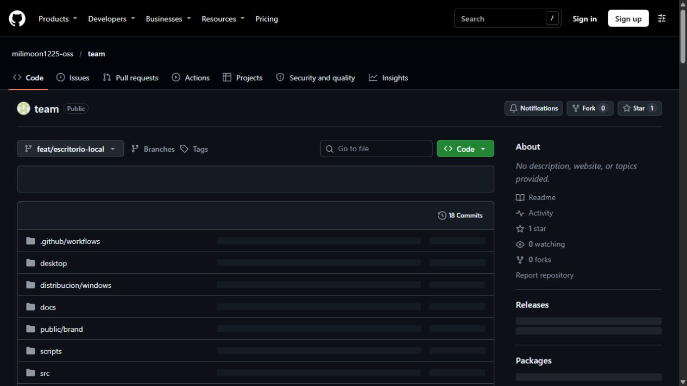

*Nota.* Captura real de GitHub. El nombre de la rama identifica la edición de escritorio utilizada en este manual.

**Resultado esperado.** Está seleccionada la rama de escritorio, con sus instrucciones de preparación.

## Paso 3. Elegir una carpeta y clonar el proyecto

1. Crea una carpeta llamada Proyectos dentro de Documentos, o utiliza otra ubicación de tu usuario.
2. Abre PowerShell desde Inicio y entra en la carpeta Proyectos. Puedes copiar su ruta desde el Explorador y utilizar cd "RUTA_DE_TU_CARPETA".
3. Ejecuta git clone. El comando creará la subcarpeta Creativa-Escritorio; no necesitas crearla antes.

```powershell
git clone --single-branch --branch feat/escritorio-local https://github.com/milimoon1225-oss/team.git Creativa-Escritorio
```

**Figura 3**

*Carpeta del proyecto después de la descarga*

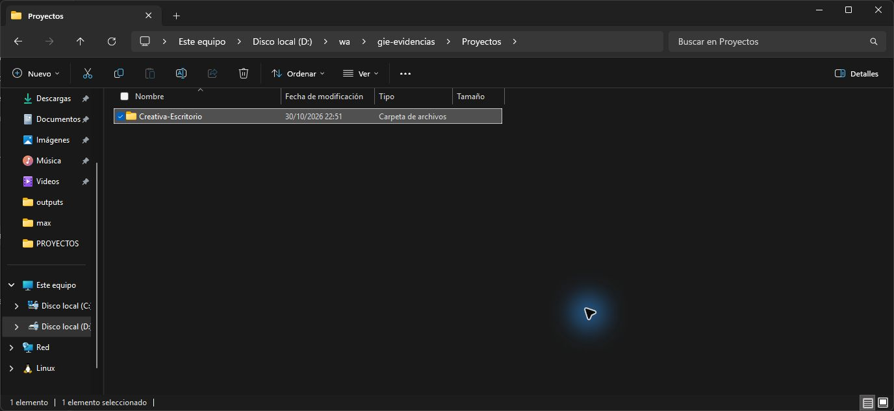

*Nota.* Captura real del Explorador. La ubicación del ejemplo no es un requisito: utiliza la carpeta que elegiste en tu equipo.

**Resultado esperado.** Existe la carpeta Creativa-Escritorio dentro de Proyectos.

## Paso 4. Entrar en la raíz del proyecto

1. En la misma PowerShell, entra en Creativa-Escritorio con el primer comando.
2. Comprueba que package.json exista; Test-Path debe devolver True.
3. En el Explorador, identifica package y package-lock si Windows oculta la extensión .json.

```powershell
cd .\Creativa-Escritorio
Test-Path .\package.json
```

**Figura 4**

*Archivos que identifican la raíz del proyecto*

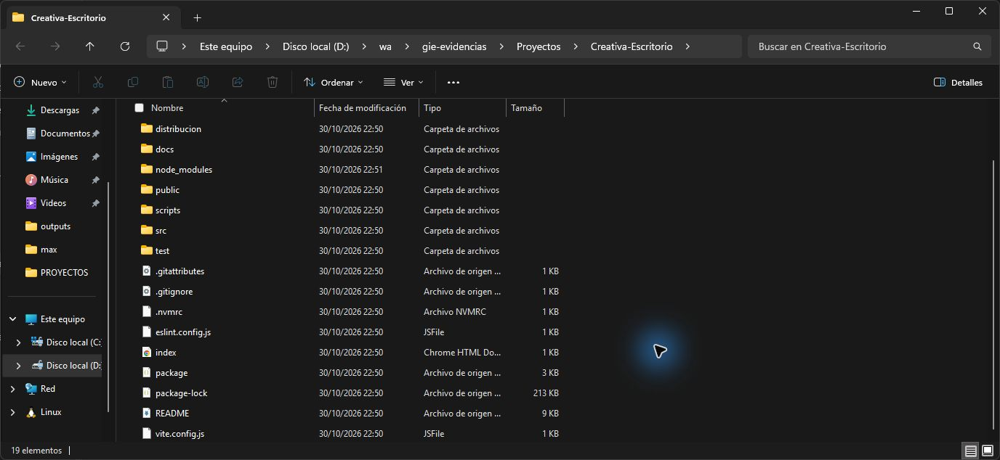

*Nota.* Captura real. package.json y package-lock.json están junto a src y scripts. node_modules y dist aparecen después de preparar y compilar.

**Resultado esperado.** La terminal está en la carpeta que contiene package.json.

## Paso 5. Instalar las dependencias

1. Mantén PowerShell en la raíz del proyecto.
2. Ejecuta npm.cmd ci con conexión a internet.
3. Espera a que el comando termine y vuelva a aparecer el indicador de la terminal.

```powershell
npm.cmd ci
```

**Figura 5**

*Instalación real de las dependencias*

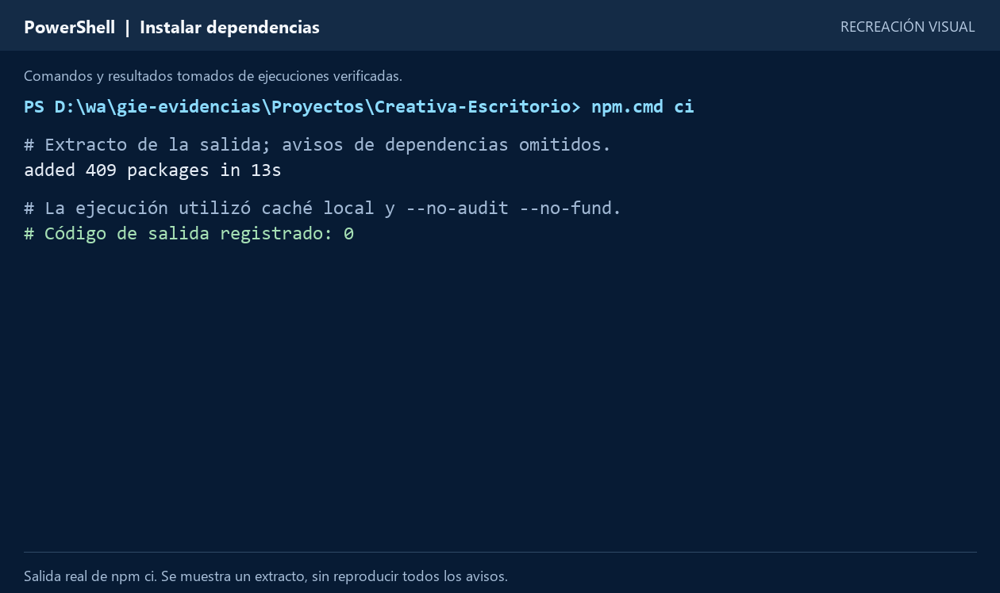

*Nota.* Captura real de Git Bash. Se instalaron 409 paquetes y se auditaron 410. npm informa 20 vulnerabilidades: 19 moderadas y 1 alta. Estos avisos no deben ocultarse.

**Resultado esperado.** Se creó node_modules y no hay un error que impida continuar.

## Paso 6. Preparar el motor Electron

1. Ejecuta setup:desktop desde la misma carpeta.
2. Espera la descarga si el motor todavía no está disponible.
3. Si el motor ya existe, el comando puede terminar sin mostrar más mensajes.

```powershell
npm.cmd run setup:desktop
```

**Figura 6**

*Comprobación real del motor de escritorio*

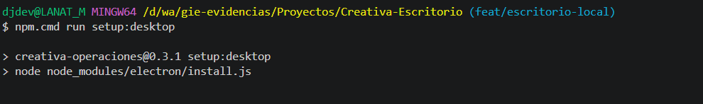

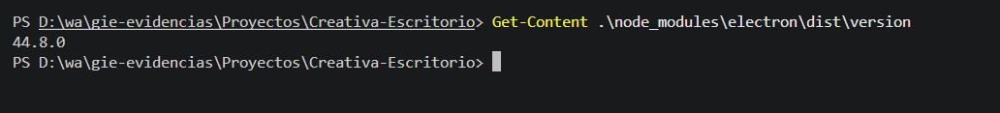

*Nota.* Capturas reales: setup:desktop en Git Bash y consulta de la versión en PowerShell. El motor preparado es Electron 44.8.0.

**Resultado esperado.** El motor Electron está disponible para abrir la aplicación.

## Paso 7. Revisar el diagnóstico

1. Ejecuta el diagnóstico antes de abrir la aplicación.
2. Revisa las comprobaciones de Node.js, dependencias y Electron.
3. Un aviso de IA no impide usar la gestión local. Si hay ERROR en el entorno, corrige ese punto antes de seguir.

```powershell
npm.cmd run diagnostico
```

**Figura 7**

*Diagnóstico real del entorno preparado*

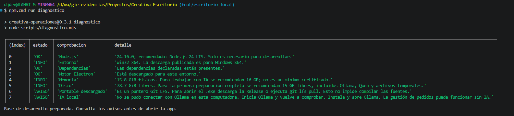

*Nota.* Captura real de Git Bash. La base de desarrollo está preparada. Se conservan los avisos del puntero Git LFS y de Ollama sin conexión; no impiden compilar las fuentes ni utilizar la gestión local.

**Resultado esperado.** El entorno está preparado; los avisos opcionales están identificados.

## Paso 8. Reconocer una compilación correcta

1. Si quieres comprobar la compilación por separado, ejecuta build.
2. Espera a que aparezca built in y termine el proceso.
3. Comprueba que exista dist\index.html. Una advertencia de tamaño de archivos no equivale por sí sola a un error de compilación.

```powershell
npm.cmd run build
```

**Figura 8**

*Resultado real de la compilación de la interfaz*

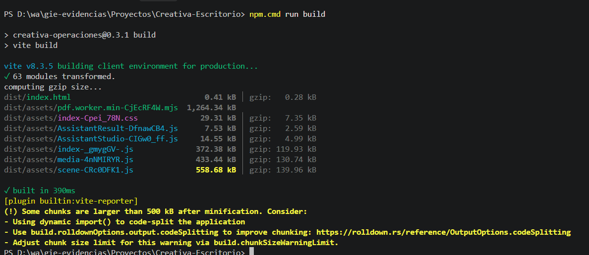

*Nota.* Captura real de PowerShell: 63 módulos transformados y compilación terminada en 390 ms. Se conserva el aviso de archivos que superan 500 kB.

**Resultado esperado.** La interfaz compilada está en dist. Este paso también se realiza automáticamente al usar start.

## Paso 9. Abrir Creativa desde las fuentes

1. Ejecuta start desde la raíz del proyecto.
2. Mantén la terminal abierta mientras utilizas Creativa.
3. En el primer inicio, puedes pulsar Explorar demostración para recorrer las pantallas sin crear un espacio permanente.

```powershell
npm.cmd start
```

**Figura 9**

*Creativa abierta con datos de demostración*

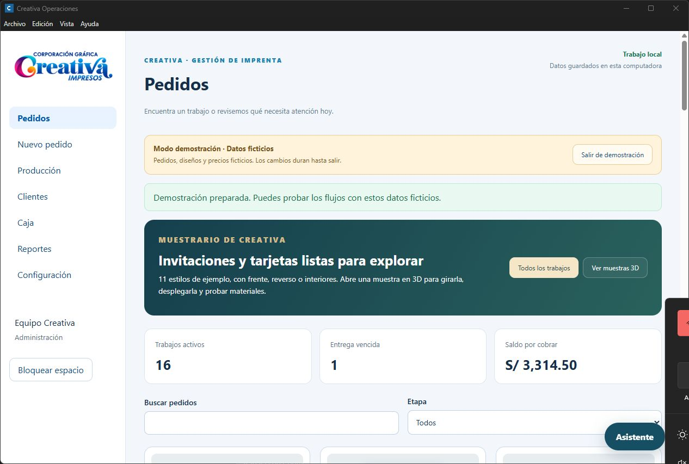

*Nota.* Captura real de la aplicación. Todos los clientes, pedidos e importes de la demostración son ficticios.

**Resultado esperado.** Aparece la ventana de Creativa. Para esta edición de escritorio utiliza start; dev está destinado al desarrollo de pantallas.

## Paso 10. Descargar el ejecutable oficial

1. Abre la publicación desktop-v0.3.1 del repositorio y busca Assets.
2. Descarga Creativa-Operaciones-0.3.1-x64-Portable.exe.
3. Espera a que termine la descarga y utiliza Mostrar en carpeta o entra en Descargas.

Publicación oficial: https://github.com/milimoon1225-oss/team/releases/tag/desktop-v0.3.1

**Figura 10**

*Archivos de la publicación oficial de Creativa*

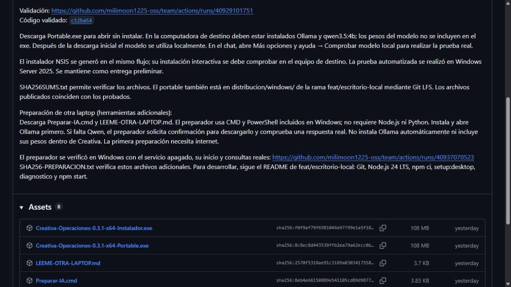

*Nota.* Captura real. El portable publicado ocupa 112 931 898 bytes, aproximadamente 108 MiB. La entrega está marcada como preliminar.

**Resultado esperado.** El .exe completo está en tu computadora. El portable se abre directamente; no requiere un asistente de instalación.

## Paso 11. Primer inicio: prueba o trabajo permanente

1. Haz doble clic en el portable y espera a que aparezca la pantalla inicial.
2. Para explorar, elige Explorar demostración. Sus cambios duran hasta salir.
3. Para conservar trabajo, escribe el responsable, elige un PIN de 6 a 12 dígitos, repítelo y pulsa Preparar y comenzar.

**Figura 11**

*Opciones reales del primer inicio de Creativa*

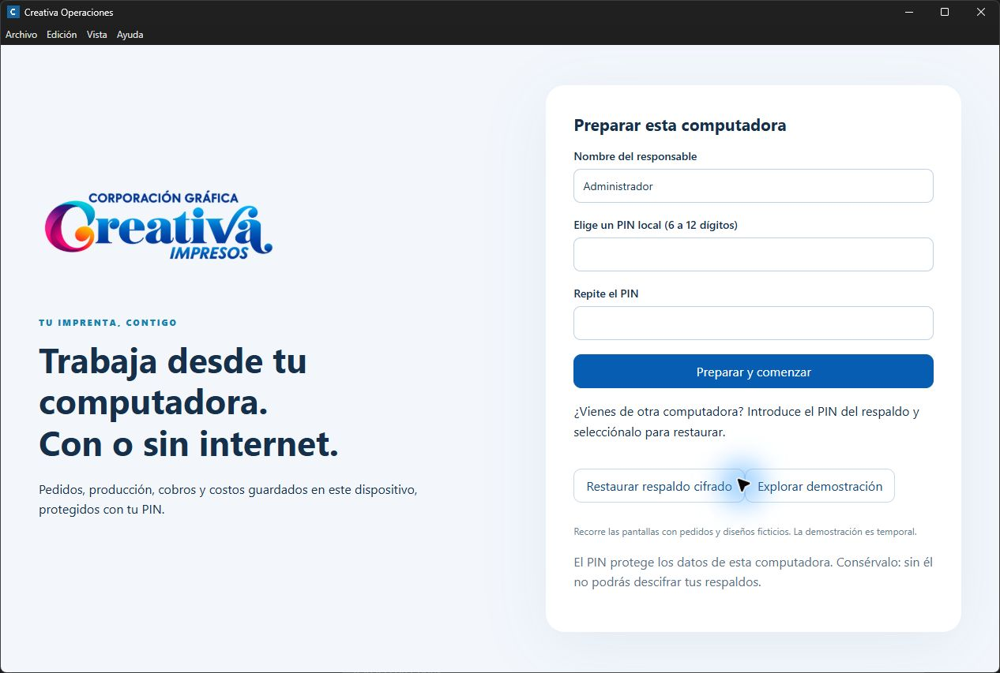

*Nota.* Captura real. La demostración temporal y el espacio protegido con PIN tienen propósitos distintos.

**Resultado esperado.** Puedes recorrer los ejemplos o abrir un espacio permanente. Conserva el PIN para volver a entrar y descifrar tus respaldos.

## Paso 12. Preparar la IA local, si la vas a utilizar

1. Instala Ollama desde https://ollama.com/download/windows y ábrelo.
2. Descarga Preparar-IA.cmd desde la misma publicación oficial de Creativa.
3. Ejecuta el preparador y confirma la descarga de qwen3.5:4b si hace falta. Se necesitan internet y espacio libre durante esta preparación.

Como alternativa, con Ollama instalado y abierto, puedes descargar el modelo desde PowerShell:

```powershell
ollama pull qwen3.5:4b
```

*Nota.* Ollama requiere Windows 10 22H2 o posterior y espacio adicional para el modelo (Ollama, s. f.). La gestión local de Creativa puede utilizarse sin preparar IA.

**Resultado esperado.** Ollama está abierto y el modelo está descargado. Los pesos, de aproximadamente 3,3 GB, no se incluyen dentro del portable.

## Paso 13. Comprobar una respuesta real del modelo

1. En Creativa abre el Asistente.
2. Entra en Más opciones y ayuda y pulsa Comprobar modelo local.
3. Espera la respuesta. La confirmación esperada es Qwen3.5:4b respondió correctamente.

Si utilizas las fuentes, también puedes comprobar una respuesta real desde la raíz del proyecto:

```powershell
npm.cmd run diagnostico -- --modelo
```

*Nota.* La IA real no se verificó porque Ollama no respondía. La figura del diagnóstico recoge ese aviso; no se presenta una confirmación simulada.

**Resultado esperado.** El modelo devuelve una respuesta válida. Tenerlo descargado no sustituye esta comprobación.

## Paso 14. Conservar los datos y cerrar el trabajo

1. Para trabajo que necesites conservar, utiliza el espacio con responsable y PIN.
2. Desde Configuración, descarga un respaldo cifrado y guárdalo en una ubicación privada.
3. Cierra Creativa al terminar. Antes de cambiar de computadora, conserva el respaldo y su PIN.

Los datos se guardan por usuario de Windows en %APPDATA%\Creativa-Operaciones. Copiar solo el .exe no traslada tus pedidos. Restaura el respaldo desde un perfil vacío del equipo nuevo; los espacios no se fusionan.

Ollama y el modelo se preparan por separado en cada computadora. No elimines carpetas de datos reales para corregir problemas de instalación.

**Resultado esperado.** La persona responsable distingue la aplicación, sus datos persistentes y el respaldo que permite recuperarlos.

## Solución de incidencias

Conserva el texto del error y vuelve a ejecutar únicamente el paso que falló. Las advertencias opcionales deben distinguirse de los errores que impiden continuar.

**Tabla 2**

*Incidencias habituales y acciones de recuperación*

| Síntoma | Solución |
| --- | --- |
| git, node o npm no se reconocen | Comprueba la instalación y abre otra PowerShell. Repite los comandos de versión. |
| PowerShell bloquea npm.ps1 | Utiliza npm.cmd como en esta guía. No cambies la política global de ejecución. |
| No se encuentra package.json | Entra con cd a Creativa-Escritorio y comprueba Test-Path .\package.json. |
| Falta Electron o la descarga falla | Ejecuta setup:desktop con internet. Revisa la conexión o el proxy antes de reintentar. |
| El .exe es muy pequeño o no abre | Puede ser un puntero de Git LFS. Descarga el portable completo desde la Release. |
| Windows muestra editor desconocido | La entrega no tiene firma comercial. Verifica el origen y SHA256SUMS.txt. Si existe un bloqueo organizacional, pide autorización. |
| Ollama no responde o falta el modelo | Abre Ollama, ejecuta el preparador o descarga qwen3.5:4b. Repite la comprobación real. |
| Los cambios de prueba desaparecen | La demostración es temporal. Prepara el espacio con responsable y PIN para trabajo permanente. |

## Referencias

American Psychological Association. (2021). Figure setup. APA Style. https://apastyle.apa.org/style-grammar-guidelines/tables-figures/figures

American Psychological Association. (2026). Font. APA Style. https://apastyle.apa.org/style-grammar-guidelines/paper-format/font

Creativa Impresos. (2026). Creativa Operaciones (versión 0.3.1) [Software]. GitHub. https://github.com/milimoon1225-oss/team/tree/feat/escritorio-local

Git Project. (s. f.). Install for Windows. https://git-scm.com/install/windows

Ollama. (s. f.). Windows. https://docs.ollama.com/windows

OpenJS Foundation. (s. f.). Download Node.js. https://nodejs.org/en/download
